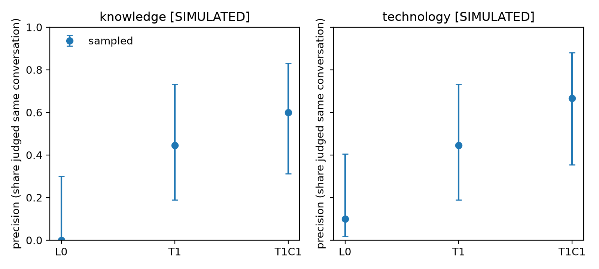
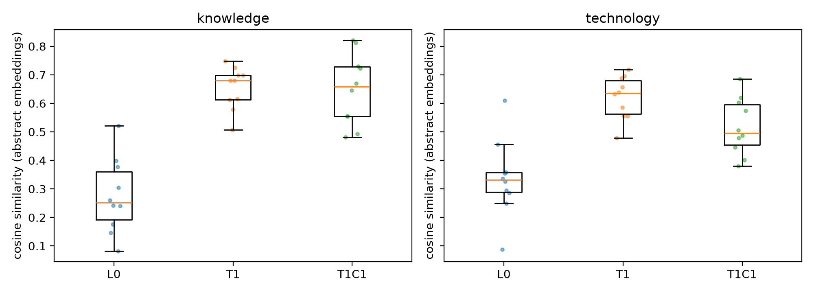

# Technical Appendix

*Can AI Traverse the “Right” Graph of Research Conversations? The Challenge of Context for AI-Assisted Referencing*

## A1. Overview

The prototype tests one claim: retrieval by semantic similarity, the basis of LLM literature tools, does not reliably recover research conversations, because conversations are constituted socially as well as textually. It compares three retrieval conditions against expert judgments of whether two papers belong to the same conversation.

Each condition corresponds to a layer of referencing. A fourth, pragmatic layer (standpoint, timing, the politics of citation) is not a retrieval condition; in the full design it is studied through disagreement among expert coders.

| Layer | What links two papers | Operationalized as |
|---|---|---|
| Lexical | Shared words | Random pairs from a keyword frame (database search) |
| Semantic | Shared meaning in text | Same topic in a topic model over sentence embeddings (the LLM view) |
| Socio-semantic | Shared meaning within a scholarly community | Same topic and same community in the co-authorship graph |
| Pragmatic | Standpoint, timing, politics of citation | Expert judgments and their disagreement (full design) |

All code, data, outputs and the run configuration are in the anonymized repository. The notebook `notebooks/Conversations AIEFOS Proposal Prototype.ipynb` reproduces every number in this appendix; section numbers below refer to the notebook where relevant. The prototype design (three conditions, 10 pairs per condition, two tracks) shows direction and effect size with intervals, plus qualitative cases. It is not a confirmatory test.

## A2. Corpus

The corpus holds 28,620 papers published 2000–2023 in 20 journals, of which 27,955 (97.7%) have abstracts. Records come from a Scopus export (`data/papers.parquet`: title, cleaned abstract, raw abstract, journal, year, citation count). Authorship is in `data/authorships.parquet`: 79,470 paper–author rows for 35,476 authors, keyed on Scopus author IDs, which avoids name-disambiguation errors.

| Journal | Field | Papers |
|---|---|---:|
| Technological Forecasting and Social Change | Innovation, technology | 5,489 |
| Research Policy | Innovation, technology | 3,020 |
| Journal of Applied Psychology | Organizational behavior | 2,283 |
| Strategic Management Journal | Strategy | 1,994 |
| Organization Science | Organization theory | 1,550 |
| Organization Studies | Organization theory | 1,527 |
| Academy of Management Journal | General management | 1,475 |
| Journal of Management | General management | 1,399 |
| Journal of Organizational Behavior | Organizational behavior | 1,347 |
| Journal of Management Studies | General management | 1,331 |
| Organizational Behavior and Human Decision Processes | Organizational behavior | 1,232 |
| Journal of International Business Studies | International business | 1,207 |
| Information Systems Research | Information systems | 986 |
| MIS Quarterly | Information systems | 780 |
| Journal of Management Inquiry | Organization theory | 772 |
| Academy of Management Review | General management | 590 |
| Strategic Organization | Strategy | 473 |
| Administrative Science Quarterly | Organization theory | 464 |
| Journal of Strategic Information Systems | Information systems | 395 |
| Information and Organization | Information systems | 306 |

The journals span the communities the argument depends on: organization theory, organizational behavior, strategy, information systems, and innovation studies study overlapping phenomena under different vocabularies. *Technological Forecasting and Social Change* (19% of papers) is kept in the topic model and the co-authorship network, so that topics and communities reflect the full field, but excluded from the keyword frames (A4), where its forecasting and futures orientation would dominate the technology track.

For Stage 2 the corpus will be rebuilt on open metadata (OpenAlex), with DOIs retained as crosswalks, to broaden coverage and ease reuse.

## A3. Representations

Three representations are fitted once on the full corpus, never on the keyword frames, so that frame selection cannot shape them.

**Embeddings (notebook §2).** Title and abstract are embedded with `sentence-transformers/all-mpnet-base-v2`, an open-weight general-purpose model (768 dimensions, L2-normalized). We deliberately avoid citation-trained scientific models such as SPECTER for the primary analysis: they build citation structure into the embedding and would blur the line between the semantic and social conditions. SPECTER is a planned robustness check (A10).

**Topics (§3).** BERTopic over the embeddings, with UMAP (15 neighbors, 5 components, minimum distance 0, cosine metric, fixed seed) and HDBSCAN (minimum cluster size 20, minimum samples 5). This yields 290 topics with a median size of 44 papers; 35.7% of papers are HDBSCAN outliers and are excluded from same-topic conditions. A coarser setting (minimum cluster size 40) yields about 130 topics and is cached for robustness checks.

**Co-authorship communities (§4).** Authors are nodes; edge weights count co-authored papers. The graph has 35,476 authors and 120,871 ties; its giant component holds 67.9% of authors. Communities come from Leiden (RB-configuration, resolution 1.0, fixed seed), with modularity quality 0.854 and 2,925 non-singleton communities. Each paper takes the plurality community of its authors, ties going to the larger community; the share of authors in that community is stored as `comm_purity`. Authors who never co-author form singleton communities, so their papers cannot enter a same-community condition.

## A4. Keyword frames and retrieval conditions

Each track starts from a keyword frame, the set a database keyword search would return. A frame is every paper with an abstract, published 2000–2023, outside *Technological Forecasting and Social Change*, whose title or abstract matches the track's pattern (case-insensitive regular expression).

| Track | Pattern | Frame papers | Topics with frame papers | Usable for same-topic conditions | Top-10 topics' share of frame |
|---|---|---:|---:|---:|---:|
| Knowledge | `\bknow` | 4,336 | 260 | 2,682 (62%) | 20% |
| Technology | `\btechnolog` | 3,578 | 220 | 2,207 (62%) | 33% |

The last column shows how dispersed each concept is: knowledge papers spread thinly across many topics, technology papers cluster more. Any non-outlier topic holding at least one frame paper can feed the same-topic conditions (`TOPIC_RULE = "all"`), which needs no thresholds and treats both tracks alike. A stricter rule, keeping only topics whose top words contain the keyword, is cached as a robustness check.

The three prototype conditions are defined over pairs of frame papers:

| Condition | Code | Pair definition | Eligible pairs (knowledge / technology) |
|---|---|---|---|
| Lexical | `L0` | Random pair from the keyword frame | ~198,000 / ~197,000 (sampled pool) |
| Semantic | `T1` | Same topic, regardless of community | 30,713 / 38,907 |
| Socio-semantic | `T1C1` | Same topic and same co-authorship community | 7,204 / 9,552 |

Semantic pairs include socio-semantic ones in proportion to their share of the pool, so `T1` represents what topic-based retrieval actually returns. Exact counts over the pool give that share: among eligible same-topic pairs, 22.2% (knowledge) and 23.3% (technology) also share a community. Among same-community pairs, only 2.0% and 4.3% share a topic. These weights are also used to derive pure semantic and pure social retrieval in the full design (A7).

## A5. Pair sampling and safeguards

The prototype samples 10 pairs per condition per track: 60 pairs in all (notebook §6). Same-topic and same-community conditions enumerate every eligible pair within their groups; the lexical condition draws random pairs from the frame. Pairs are then taken in uniformly random order, so each eligible pair has the same chance of selection. The scarcest condition (`T1C1`) is sampled first.

- **No shared authors.** No pair shares an author, so same-community pairs are not trivially the same team.
- **No reuse.** No paper appears in more than one pair, across both tracks.
- **Blind conditions.** Pairs are shuffled and the condition key is written to a separate file (`outputs/<track>_key.csv`), withheld from coders.
- **Hidden social cues.** Author names are hidden from coders (`SHOW_AUTHORS = False`). Journal and year will also be hidden: in informal trial coding, the venues of the two papers strongly shaped judgments.
- **Full-corpus models.** Topic model and network are fitted on the whole corpus, not on the frames (A3).
- **Fixed seed.** One seed (20261101) governs sampling, so the sample is reproducible.

## A6. Labeling protocol

Each track produces one blind spreadsheet (`outputs/<track>_labeling_<coder>.xlsx`) showing, for each pair, the two titles and abstracts and nothing about condition, topic, community or similarity (notebook §7). In the prototype one author codes each track. Coders receive this instruction:

> For each row, read both papers and judge whether they belong to the SAME RESEARCH CONVERSATION: a community of scholars engaging a shared problem, who would plausibly read, cite and respond to each other's work. Shared vocabulary or subject matter alone is not enough.

| Field | Values | Use |
|---|---|---|
| `label` | S = same conversation, D = different, U = can't tell | Outcome; U is excluded from precision and reported |
| `confidence` | 1 (guess) to 3 (certain) | Reported; sensitivity checks in the full design |
| `notes` | Free text, ideally naming the conversation(s) | Qualitative cases (A9) |

Filled sheets go in `labels/` and are read automatically on the next run. When a second coder labels the same track, the notebook reports Cohen's κ. In the full design several coders label each track and agreement is related to coders' own positions in the field (A10).

## A7. Analysis

The outcome is each condition's precision: the share of its pairs judged "same conversation" (notebook §8). The prediction is an ordering, lexical < semantic < socio-semantic, tested within each track.

- **Intervals.** Wilson 95% intervals per condition; Jeffreys posterior draws, Beta(k + ½, n − k + ½), so that conditions with 0/n still carry uncertainty.
- **Contrasts.** One-sided Fisher exact tests for semantic < socio-semantic (does social structure raise precision?) and lexical < semantic.
- **Trend.** A one-sided Cochran–Armitage test across the predicted order.
- **Cases.** With 10 pairs per condition, cases carry the argument more than the tests. The notebook exports two kinds: semantic false positives (same-topic pairs with high cosine similarity judged different) and socio-semantic hits (same-topic, same-community pairs judged the same), each with the coder's notes.

In the full design (A10), the 2×2 cells also support derived strategies. Pure semantic retrieval returns same-topic pairs that share a community with probability *w* and do not with probability 1 − *w* (*w* from A4), so its precision is a mixture of cells:

$$p(\mathrm{T1}) = w \, p(\mathrm{T1C1}) + (1 - w) \, p(\mathrm{T1C0})$$

Social retrieval is derived the same way with weight *v*. Contrasts between derived strategies use differences of posterior draws. A logistic model of same-conversation judgments on shared topic, shared community and their interaction, with track fixed effects, is estimated alongside a linear probability model with HC3 errors as a check against separation.

## A8. Simulated labels and power

No expert labels exist yet. Until they do, the notebook generates simulated labels so that the whole pipeline can be checked end to end; every output from such a run is stamped SIMULATED and none is reported as a result.

Simulated labels draw "same" with an assumed precision per condition: 0.05 lexical, 0.27 semantic, 0.65 socio-semantic (full-design cells: 0.25 same topic only, 0.40 same community only, 0.05 neither), with 5% "can't tell". These values encode the hypothesis; they are not estimates.

*Figure A1. Precision by condition from one run on simulated labels (10 pairs per condition), with Wilson 95% intervals. The figure illustrates the pipeline's output; it is not data.*

One simulated run at 10 pairs per condition illustrates the design's limits. The trend test detects the assumed ordering (one-sided p = .003 knowledge, .006 technology), but the key contrast, semantic < socio-semantic, does not (p = .41 and .32). Power for that contrast, by Monte Carlo (4,000 replications, one-sided Fisher test, α = .05, precisions 0.27 vs 0.65):

| Pairs per condition | Power |
|---|---|
| 10 | 0.37 |
| 30 | 0.87 |
| 50 | 0.98 |

This motivates about 30 pairs per cell in the full design.

## A9. Descriptive results available without labels

Two results hold before any labeling.

**Semantic retrieval mostly crosses community lines.** Of all eligible same-topic pairs, 22.2% (knowledge) and 23.3% (technology) also share a co-authorship community (A4). Roughly three of four pairs that topic-based retrieval would return therefore come from different scholarly communities.

**Socio-semantic pairs are not more textually similar.** Cosine similarity of the sampled pairs (notebook §5):

| Track | Condition | Mean cosine | Median | Range |
|---|---|---:|---:|---|
| Knowledge | Lexical | 0.28 | 0.25 | 0.08–0.52 |
| Knowledge | Semantic | 0.65 | 0.68 | 0.51–0.75 |
| Knowledge | Socio-semantic | 0.65 | 0.66 | 0.48–0.82 |
| Technology | Lexical | 0.34 | 0.33 | 0.09–0.61 |
| Technology | Semantic | 0.62 | 0.64 | 0.48–0.72 |
| Technology | Socio-semantic | 0.52 | 0.50 | 0.38–0.69 |

*Figure A2. Cosine similarity of the sampled pairs by condition (abstract embeddings). L0 = lexical, T1 = semantic, T1C1 = socio-semantic. Boxes show quartiles; points are individual pairs.*

The step from lexical to semantic is expected: sharing a topic implies similar text. The absence of a further step to socio-semantic means community membership adds no textual similarity. If experts judge socio-semantic pairs the same conversation more often, text similarity cannot account for it. These figures rest on 10 pairs per cell and are indicative only.

**Granularity caveat.** The communities behind the sampled pairs are large (median 1,200–4,550 papers per community), so "same community" is a coarse social signal at Leiden resolution 1.0. Finer resolutions would lower the overlap above and sharpen the contrast; whether the ordering of conditions holds across resolutions is part of A10.

## A10. Full design (Stage 2) and robustness checks

The notebook already implements the full design (`DESIGN = "full"`); Stage 2 supplies the labels and extensions.

| | Prototype | Full design |
|---|---|---|
| Conditions | Lexical, semantic, socio-semantic, sampled directly | Lexical plus the topic × community 2×2; pure semantic and social retrieval derived as mixtures (A7) |
| Pairs | 10 per condition, 30 per track | About 30 per cell (A8) |
| Tracks | Knowledge, technology | Additional concepts that travel across conversations under shared labels (e.g., bureaucracy, institutions, routines) |
| Coders | One author per track | 10–20 tenure-track faculty, several per track; agreement (κ) related to coders' positions in the field |
| Venue cue | Hidden | Shown to some coders and hidden from others, to measure reliance on venue |
| Corpus | 20 journals, 2000–2023, Scopus | More journals and adjacent fields (e.g., sociology, science and technology studies), longer span, rebuilt on OpenAlex |
| Key contrasts | Semantic vs socio-semantic; lexical vs semantic | Same topic, different vs same community (text held constant); semantic vs social; semantic matched to socio-semantic on cosine |

**Co-citation of anchor papers.** Pairs that cite the same foundational works will form a further condition. It signals shared intellectual lineage and scales across tracks without hand-curated lists. Because experts may recognize anchor works in abstracts, it is treated as a competing condition, not an added feature: if co-citation alone matches socio-semantic precision, what text-based retrieval misses sits in reference lists rather than in co-authorship.

**Robustness checks.**

- Topic granularity: minimum cluster size 20 vs 40 (about 290 vs 130 topics); both cached.
- Community granularity: Leiden resolutions above and below 1.0. Precision in same-topic and same-community cells rises mechanically as groups shrink, so the ordering of conditions, not their levels, is the quantity of interest.
- Topic rule: all topics with frame papers vs topics whose top words contain the keyword.
- Embedding model: other open sentence models and a citation-trained model (SPECTER), which builds citation structure into the text representation.
- Coder confidence: results restricted to confident judgments (2–3).

## A11. Reproducibility and repository contents

Apart from the power calculation in A8, every figure in the proposal and this appendix comes from one notebook run with a saved configuration (`outputs/run_config_prototype.json`; seed 20261101). Dependencies are listed in `requirements.txt` (pandas, scikit-learn, statsmodels, sentence-transformers, BERTopic, UMAP, HDBSCAN, python-igraph, leidenalg). On a laptop, the first run embeds the corpus and fits the topic model in a few minutes each; later runs load both from `cache/`.

| Path | Contents |
|---|---|
| `data/papers.parquet` | 28,620 papers: title, abstract, journal, year, citation count |
| `data/authorships.parquet` | 79,470 paper–author rows |
| `notebooks/` | The prototype notebook, sections 0–10 |
| `outputs/pair_sample.parquet` | Every sampled pair with condition, topic, community and cosine |
| `outputs/<track>_key.csv` | Condition key, withheld from coders |
| `outputs/<track>_labeling_<coder>.xlsx` | Blind labeling sheets |
| `outputs/paper_partitions.parquet`, `outputs/topics.csv` | Topic and community assignment per paper; topic words |
| `outputs/*_SIMULATED.*` | Figures and cases from simulated labels |
| `labels/` | Filled labeling sheets, read automatically when present |

To reproduce: install the requirements, open the notebook and run all sections. To switch to the full design, set `DESIGN = "full"` in the configuration cell. Large intermediate files (embeddings, topic assignments) are cached locally and will be archived with a persistent identifier for Stage 2.
